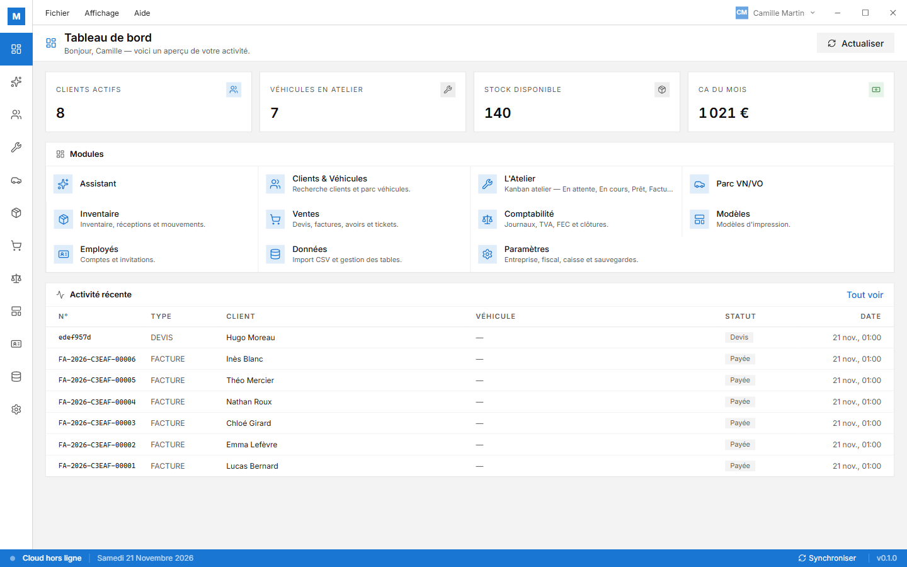
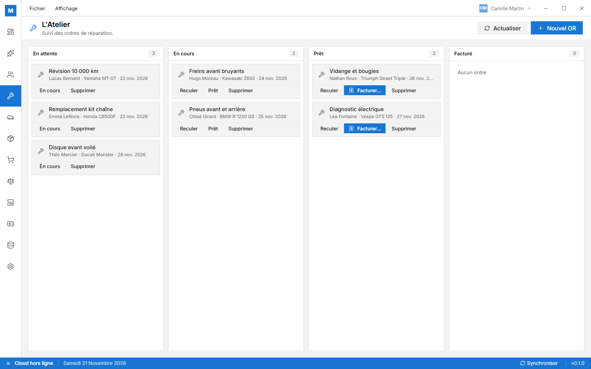
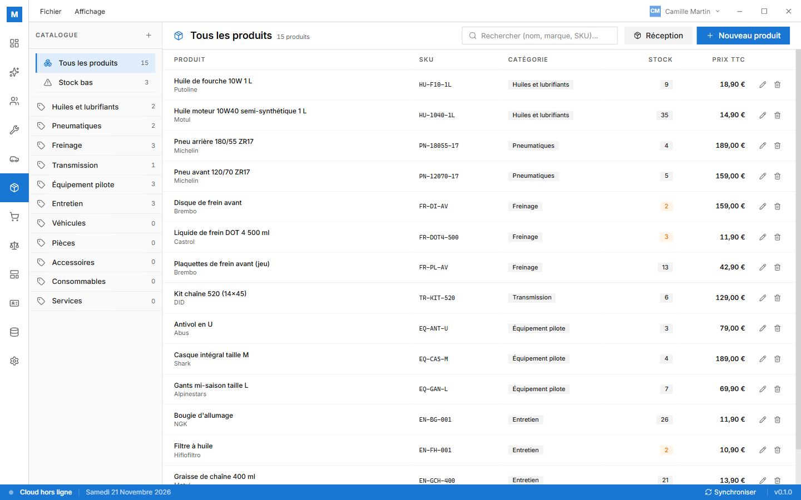
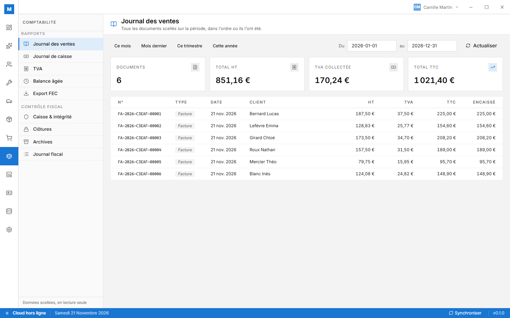

# Motodesk

**Le logiciel de gestion des ateliers et concessions moto et cycle : clients, atelier, stock, ventes, caisse et comptabilité fiscale, dans une seule application qui continue de fonctionner sans connexion.**

[](https://github.com/LeBorgneAntoine/MotoDesk/actions/workflows/ci.yml)

> **Statut : développement actif (version 0.1).** Le projet n'a pas encore de version stable publiée. Les interfaces, les formats de données et la documentation évoluent.

---

## Sommaire

- [Présentation](#présentation)
- [Aperçu](#aperçu)
- [Fonctionnalités](#fonctionnalités)
- [Architecture](#architecture)
- [Conformité fiscale](#conformité-fiscale)
- [Sécurité et données](#sécurité-et-données)
- [Démarrage rapide](#démarrage-rapide)
- [Configuration](#configuration)
- [Tests et qualité](#tests-et-qualité)
- [Produire une version](#produire-une-version)
- [Exploitation](#exploitation)
- [Structure du dépôt](#structure-du-dépôt)
- [Documentation](#documentation)
- [Contribuer](#contribuer)
- [Feuille de route](#feuille-de-route)
- [Licence et mentions](#licence-et-mentions)

## Présentation

Motodesk remplace les outils séparés d'un magasin de deux-roues (fichier clients, planning d'atelier, tableur de stock, logiciel de caisse) par une application de bureau unique.

Trois principes guident sa conception :

- **Hors ligne d'abord.** Chaque poste embarque sa propre base et son propre serveur local. Le magasin vend et répare même sans internet ; la synchronisation rattrape ensuite le retard.
- **Seul, en réseau ou en ligne.** Motodesk démarre sans aucun serveur (interrupteur *Local* de l'écran d'accès : un identifiant et un mot de passe créent le réseau de l'atelier), et peut être mis en ligne plus tard, sans ressaisie, depuis *Réglages › Synchronisation*.
- **Une caisse conçue pour le contrôle fiscal.** Les ventes sont écrites dans un journal infalsifiable (chaîné par empreintes et signé), conformément aux exigences françaises sur les logiciels de caisse.
- **Des données qui appartiennent au magasin.** Sauvegarde chiffrée sur un simple fichier, restauration sur un nouveau poste, reprise depuis un ancien logiciel de gestion.

L'interface est en français et ciblée sur Windows 10 et 11.

## Aperçu

<p align="center">
  
  
</p>
<p align="center">
  
  
</p>

*Tableau de bord, atelier, inventaire et journal des ventes. Captures réalisées avec des données fictives.*

## Fonctionnalités

| Domaine | Contenu |
|---|---|
| **Clients et parc** | Fiches clients, véhicules, parc neuf et occasion (VN/VO) vendu par facture. |
| **Atelier** | Ordres de réparation en tableau Kanban, lignes de main-d'œuvre et de pièces, facturation d'un ordre en un clic. |
| **Stock** | Catalogue avec variantes et catégories, registre de mouvements, réceptions, quantités fractionnaires exactes (millièmes d'unité). |
| **Ventes** | Devis, factures et avoirs, modèles de documents personnalisables, numérotation continue par série. |
| **Caisse** | Mode comptoir tactile : douchette, espèces, carte, chèque, attente, clôture à l'aveugle, ticket de caisse. |
| **Comptabilité** | Journaux, récapitulatif de TVA, balance âgée, export FEC, clôtures journalières, mensuelles et annuelles, archives, contrôle d'intégrité. |
| **Import** | Assistant d'import CSV (clients, produits, catégories, véhicules, ventes) et reprise en masse depuis l'ancien logiciel du magasin. |
| **Assistant** | Assistant conversationnel optionnel qui lit et agit sur les modules via les mêmes API que l'interface, avec confirmation avant toute modification. Nécessite votre propre clé OpenRouter. |
| **Équipe** | Comptes employés, rôles, invitations. |
| **Sauvegarde** | Sauvegardes chiffrées automatiques ou manuelles, restauration sur un nouvel ordinateur. |

## Architecture

```
┌──────────────────────── Poste (application native) ─────────────────────────┐
│  Interface native (Rust, GPUI)                                               │
│        │  appels directs, dans le même processus (jeton par session)         │
│        ▼                                                                     │
│  Service de données Rust (Axum) ──► SQLite (WAL) : données + journal fiscal  │
│        │                                                          signé      │
│        ├── Réseau local : mDNS _motodesk._tcp, échange de lots de changements│
│        └── Cloud : envoi et réception périodiques des changements            │
└──────────────────────────────────────┬───────────────────────────────────────┘
                                       │ HTTPS
                          ┌────────────▼────────────┐
                          │ Serveur cloud (facultatif│
                          │ projet séparé) : comptes,│
                          │ relais de synchronisation│
                          └─────────────────────────┘
```

- **Le poste est la référence.** L'interface ne parle jamais directement au cloud : elle parle au service de données du poste, qui parle à la base locale.
- **Synchronisation par journal de changements.** Chaque modification est consignée puis propagée aux autres postes (réseau local) et au cloud. La fusion se fait **champ par champ** (le plus récent l'emporte) ; une modification refusée par le cloud n'en bloque pas d'autres, elle est retentée avec un délai croissant.
- **Reprise après restauration.** Un poste restauré depuis une sauvegarde retrouve auprès du cloud les changements qu'il avait émis depuis.
- **Le cloud est facultatif.** Motodesk fonctionne seul ou en réseau local sans aucun serveur ; le serveur cloud, un projet séparé, ajoute les comptes en ligne, la réplication entre sites et la sauvegarde des changements.

Technologies : Rust de bout en bout (Axum, SQLx, [GPUI](https://gpui.rs) pour l'interface), SQLite.

## Conformité fiscale

Les ventes et règlements sont enregistrés deux fois : comme lignes ordinaires modifiables, puis comme entrée **ajoutée à la suite** d'un journal `fiscal_journal`, chaînée par empreinte (SHA-256) et signée (Ed25519). La validation d'un document est l'étape irréversible entre les deux : ensuite, seul un avoir peut le corriger.

Ce fonctionnement vise les quatre conditions de l'article 286 I-3° bis du CGI (inaltérabilité, sécurisation, conservation, archivage). La documentation technique à produire en cas de contrôle est dans [`docs/conformite-fiscale/ISCA.md`](docs/conformite-fiscale/ISCA.md).

> **À lire avant toute mise en production.** Disposer de ce code ne vaut pas conformité. L'éditeur du logiciel doit établir et signer l'attestation individuelle ([modèle](docs/conformite-fiscale/ATTESTATION.md)) et la renouveler à chaque version qui touche au code fiscal. Faites valider votre usage par votre expert-comptable.

Le journal d'un historique repris depuis un ancien logiciel n'est **pas** reconstitué : la comptabilité de Motodesk ne couvre que les ventes validées à partir du jour de bascule ([procédure de bascule](docs/migration/CUTOVER.md)).

## Sécurité et données

- **Mots de passe** hachés avec Argon2id ; sessions par jetons JWT d'accès (15 min) et de renouvellement (7 jours, renouvelé à chaque usage).
- **Secrets** (jetons de session, secret du réseau local, clés de signature des caisses, mot de passe de sauvegarde) rangés dans le trousseau du système (Gestionnaire d'identifiants Windows). À défaut de trousseau, les clés de signature restent dans la base : la chaîne est préservée, mais la signature n'est plus une preuve indépendante.
- **Sauvegardes** `.mgbak` chiffrées (AES-256-GCM, clé dérivée du mot de passe par PBKDF2) contenant la base, les archives fiscales et les clés de signature.
- **Données locales** : `%APPDATA%\com.motodesk.app\` (base `local.db`, sauvegardes, archives).
- **Signaler une faille** : n'ouvrez pas de ticket public. Utilisez le signalement privé de vulnérabilités de GitHub (onglet *Security* du dépôt).

## Démarrage rapide

### Prérequis

- Windows 10 ou 11 (cible principale ; le code compile aussi sous Linux, utilisé par l'intégration continue)
- [Rust](https://rustup.rs) (chaîne stable récente), avec les outils de compilation C++ de Visual Studio sous Windows

### Lancer l'application

```powershell
cargo run -p motodesk-gpui
```

L'application démarre **sans aucun serveur**. À l'écran d'accès, l'interrupteur **Local** permet de créer le réseau de l'atelier à partir d'un identifiant et d'un mot de passe ([détails et état d'avancement](docs/standalone.md)). Pour essayer les comptes en ligne, il faut un serveur cloud (projet séparé) dont l'adresse se règle avec `MOTODESK_CLOUD_URL`.

### Lancer une seconde instance isolée

Pour une démonstration ou des captures d'écran, sans toucher aux données ni au trousseau de l'installation réelle, donnez un profil à la copie :

```powershell
$env:MOTODESK_PROFILE = "demo"
cargo run -p motodesk-gpui
```

`MOTODESK_PROFILE` range les secrets de la copie sous leur propre nom dans le trousseau, lui donne son propre dossier de données (`%APPDATA%\com.motodesk.app.demo`) et empêche la reprise des données d'une installation précédente. Une copie ainsi isolée ne s'inscrit jamais au démarrage de Windows. `MOTODESK_DATA_DIR` désigne un autre dossier de données ; `cargo run -p motodesk-gpui --example seed -- <dossier>` en remplit un de données fictives.

## Configuration

| Variable | Rôle |
|---|---|
| `MOTODESK_CLOUD_URL` | Adresse du serveur cloud. **Réglage de compilation** (lu par la partie Rust et par l'écran de connexion) ; peut aussi surcharger à l'exécution. |
| `MOTODESK_LAN_PEERS` | Adresses de postes du réseau local à joindre en plus de la découverte mDNS. |
| `MOTODESK_FISCAL_NO_KEYCHAIN` | Désactive le trousseau système (tests et développement). |
| `MOTODESK_PROFILE` | Fait tourner une copie isolée de l'application : secrets sous un nom de trousseau propre, sans reprise des données d'une installation précédente. |

Sans `MOTODESK_CLOUD_URL`, une version pointe sur `http://127.0.0.1:8080`, ce qui ne convient qu'au développement : une version de production compilée ainsi l'indique dans *Réglages › Synchronisation* et ne synchronise pas.

## Tests et qualité

```powershell
cargo clippy --workspace --all-targets
cargo test --workspace
cargo run -p motodesk-ui --example gallery     # tous les composants du kit d'interface
```

Les règles du kit d'interface (pas de couleur ni de taille en dur dans un écran, coins carrés) sont vérifiées par un test (`desktop-gpui/tests/ui_rules.rs`).

L'intégration continue ([`.github/workflows/ci.yml`](.github/workflows/ci.yml)) les exécute à chaque *push*.

## Produire une version

```powershell
cargo install cargo-packager --locked --version 0.11.8     # une fois
$env:MOTODESK_CLOUD_URL = "https://votre-cloud.example"
cargo packager --release -p motodesk-gpui
```

L'installateur Windows (par utilisateur, sans droits d'administrateur) est produit dans `target/release/`. Il n'est pas signé pour les mises à jour : la signature se fait à la publication.

Publier une version aux installations existantes (installateur signé, notes de version, bandeau « Nouvelle version disponible ») : [`docs/mises-a-jour.md`](docs/mises-a-jour.md).

## Exploitation

- **Sauvegarde et nouveau poste.** *Réglages › Sauvegardes* (administrateur) : un fichier `.mgbak` chiffré ; les sauvegardes automatiques demandent un mot de passe que vous choisissez et conservez ailleurs. À la restauration, la base remplacée est gardée à côté. Détails dans [`docs/migration/CUTOVER.md`](docs/migration/CUTOVER.md).
- **Clé de signature de caisse perdue.** L'outil en ligne de commande `motodesk-keytool` diagnostique la clé de chaque caisse et la répare en déclarant la nouvelle clé dans le journal, sans casser la chaîne :

  ```powershell
  cargo run -p motodesk-gpui --bin motodesk-keytool -- diagnose --db "$env:APPDATA\com.motodesk.app\local.db"
  ```

  Procédure complète (en anglais) : [`docs/KEY-REPAIR.md`](docs/KEY-REPAIR.md).
- **Reprise depuis un ancien logiciel.** Import en masse ou par assistant : [`docs/migration/CUTOVER.md`](docs/migration/CUTOVER.md).

## Structure du dépôt

```
├─ crates/
│  ├─ motodesk-core/         types partagés (entités, changements, synchronisation)
│  ├─ motodesk-fiscal/       journal chaîné et signé, numérotation, moteur de TVA, clôtures
│  ├─ motodesk-sync/         application des changements et fusion champ par champ
│  ├─ motodesk-db/           accès partagé au journal de changements
│  ├─ motodesk-server/       service de données embarqué : API locale, SQLite, migrations, journal fiscal, synchronisation
│  ├─ motodesk-client/       accès typé au service de données pour l'interface ; documents imprimés, mises à jour
│  └─ motodesk-ui/           kit d'interface (GPUI) : jetons, thèmes, composants, galerie
├─ desktop-gpui/             l'application : fenêtre, écrans, zone de notification, mises à jour, installateur, outil de réparation de clé
├─ tools/release/            outil de publication : notes de version, signature de l'installateur, manifeste des mises à jour
└─ docs/                     caisse, conformité fiscale, assistant, bascule, réseau local, réparation de clé
```

Le serveur cloud n'est pas dans ce dépôt : c'est un projet séparé qui réutilise les `crates/`.

## Documentation

| Sujet | Document |
|---|---|
| Conformité ISCA (pièce de contrôle) | [`docs/conformite-fiscale/ISCA.md`](docs/conformite-fiscale/ISCA.md) |
| Attestation individuelle (modèle) | [`docs/conformite-fiscale/ATTESTATION.md`](docs/conformite-fiscale/ATTESTATION.md) |
| Caisse : utilisation | [`docs/caisse/CAISSE.md`](docs/caisse/CAISSE.md) |
| Caisse : architecture | [`docs/caisse/ARCHITECTURE.md`](docs/caisse/ARCHITECTURE.md) |
| Mentions du ticket de caisse | [`docs/caisse/TICKET.md`](docs/caisse/TICKET.md) |
| Assistant | [`docs/assistant/ARCHITECTURE.md`](docs/assistant/ARCHITECTURE.md) |
| Réseau local sans cloud, mise en ligne | [`docs/standalone.md`](docs/standalone.md) |
| Dossier partagé (fichiers sensibles chiffrés, copiés entre postes) | [`docs/dossier-partage.md`](docs/dossier-partage.md) |
| Mises à jour (signature, publication, clé) | [`docs/mises-a-jour.md`](docs/mises-a-jour.md) |
| Bascule depuis un ancien logiciel, nouveau poste | [`docs/migration/CUTOVER.md`](docs/migration/CUTOVER.md) |
| Réparation d'une clé de signature | [`docs/KEY-REPAIR.md`](docs/KEY-REPAIR.md) |
| Interface native : journal de la migration depuis Svelte et Tauri, règles du kit, méthode | [`docs/migration/GPUI.md`](docs/migration/GPUI.md) |

## Contribuer

1. Partir de `master` et créer une branche par sujet (`feat/…`, `fix/…`, `chore/…`).
2. Écrire les tests avec le changement ; la CI doit être verte.
3. Messages de commit au format [Conventional Commits](https://www.conventionalcommits.org/fr/).
4. Ouvrir une *pull request* vers `master` ; elle est fusionnée par rebase une fois la CI verte.

Pour ajouter un module : exposer ses routes côté service (`crates/motodesk-server/src/local_server/routes/`), leurs appels typés dans `crates/motodesk-client`, puis son écran dans `desktop-gpui/src/pages/`, à brancher dans `shell.rs`. Un écran n'importe que le kit (`motodesk_ui`) : couleurs et tailles viennent de ses jetons, et un test refuse les valeurs en dur (voir « Les règles du kit » dans [`docs/migration/GPUI.md`](docs/migration/GPUI.md)).

## Feuille de route

- Rendez-vous, de l'ordre de réparation à la facture, réservation de pièces
- Commandes fournisseurs au-delà des réceptions
- Fidélité, tarifs, SMS
- Synchronisation en temps réel
- Protocole natif de terminal de paiement (Concert)

## Licence et mentions

Le code est publié pour que chacun puisse le lire et le vérifier (c'est ce qui permet de s'y fier), mais ce n'est **pas** un logiciel libre : tous les droits sont réservés. Voir [`LICENSE`](LICENSE).

Motodesk n'est affilié à aucun éditeur de logiciel tiers. Les noms de logiciels ou de services cités dans la documentation (logiciels repris à l'import, OpenRouter, etc.) le sont à titre d'identification, et appartiennent à leurs propriétaires respectifs.
