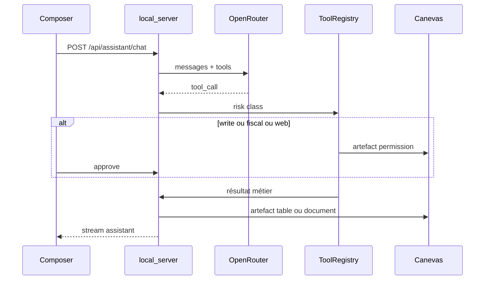

# Architecture de l'assistant

L'assistant est un atelier de travail **dans** Motodesk : une conversation à gauche, un *canevas* à droite. Il ne remplace pas les modules (clients, stock, caisse). Il les **appelle**.

Domaine : *assistant*, *conversation*, *canevas*, *artefact*, *outil*, *routine*.

## Produit

Un mécanicien ou un gérant demande, en français, de chercher un client, de préparer un devis, de sortir un tableau de stock bas, de rédiger un compte-rendu. L'assistant :

1. lit et écrit via les **mêmes** API locales que l'UI ;
2. affiche le résultat sur le canevas (tableau, indicateurs, document, graphique) ;
3. **demande l'autorisation** avant toute mutation ;
4. peut chercher sur le web si on le lui autorise ;
5. pourra, plus tard, enchaîner ces gestes en *routines*.

Phase 1 (cette coupe) : conversations SQLite, chat streamé via OpenRouter depuis `local_server`. Aucun outil métier.

## Pourquoi pas un serveur MCP réseau

Un MCP exposé sur le loopback (ou pire, le LAN) serait une deuxième surface d'attaque et une deuxième vérité métier. Ce qu'on reprend de MCP, c'est la **forme** :

| Contrat | Chez nous |
| --- | --- |
| nom + description + schéma JSON | registre d'outils dans `local_server` |
| le modèle choisit un outil | OpenRouter, API compatible OpenAI *tools* |
| l'hôte exécute | la route locale déjà existante (`/api/clients`, `/api/products`, `/api/sales`, …) |

Le registre vit en Rust, à côté de SQLite. Le webview n'implémente pas de couche métier parallèle. Pas de `fetch` OpenRouter depuis Svelte : la clé ne quitte pas le process local.

```text
Composer (Svelte)
    → POST /api/assistant/chat
        → OpenRouter (clé keychain, SSE)
    ← start / delta / done
        → artefact markdown sur le canevas
    (plus tard : tool_call → ToolRegistry)
```

## Règles dures : secret, vie privée, fiscal

**Clé OpenRouter.** Jamais dans le renderer, jamais dans `app_settings`. Ces lignes sont répliquées en mesh (`EntityType::AppSetting`) : y mettre `sk-or-…` l'enverrait sur tous les postes et dans le cloud. Même motif que le secret mesh et que `pos.store.json` : keychain OS (`secrets.rs`, utilisateur `openrouter-api-key`), avec un fichier appareil `openrouter.key` à côté de SQLite si le coffre Windows n'est pas lisible. Le modèle par défaut est une préférence **machine** (`assistant.store.json`), pas un réglage d'atelier.

**Conversations.** SQLite local, **pas** un `EntityType`. Elles portent du nominatif (clients, plaques, montants). Elles ne se synchronisent pas. Backup atelier : à trancher plus tard ; aujourd'hui la clé OpenRouter n'est pas dans l'archive chiffrée.

**Écritures.** Un outil `write` ou `fiscal` s'arrête sur une carte d'autorisation **dans le canevas** — pas un `window.confirm`. Refuser n'écrit rien. Les lignes du journal fiscal restent append-only : l'assistant ne « corrige » pas une facture scellée. Un avoir emprunte le chemin `seal_in_tx` déjà en place.

**Web.** Jamais implicite. Soit un réglage, soit une autorisation une fois par tour (`risk: web`). Pas de scraping depuis le webview.

## OpenRouter

Tout le trafic LLM part de `local_server` (client `reqwest` déjà dans l'état). En-têtes : `Authorization: Bearer`, `HTTP-Referer`, `X-Title: Motodesk`.

Le sélecteur de modèle est une liste courte (Claude, GPT, Gemini, un petit modèle) plus un slug libre `fournisseur/modèle`. Les identifiants OpenRouter bougent : ne pas les graver dans une migration.

Recherche web (phase 5) : modèles `:online` ou plugins OpenRouter, pas un navigateur embarqué.

Test de connexion (phase 0) : `GET https://openrouter.ai/api/v1/models` avec la clé stockée. Le renderer ne voit que `{ configured, hint }` (`sk-or-…xxxx`).

## Canevas

Le volet droit est un **hôte**. Les widgets viennent du kit (`DataTable`, `KpiTile`, `Alert`, `InfoList`). Union discriminée :

| `kind` | Rendu |
| --- | --- |
| *(aucun)* | `StateView` vide |
| `markdown` | note / rapport (`Prose`) |
| `table` | `DataTable` |
| `kpis` | rangée de `KpiTile` |
| `chart` | plus tard, sans librairie tant qu'un bâton CSS + kit suffisent |
| `document_preview` | aperçu devis / facture (lecture) |
| `permission` | carte Approuver / Refuser |
| `question` | question de clarification (champs kit) |
| `web_results` | sources web, plus tard |

Un tour peut empiler plusieurs artefacts. Le bouton en haut à droite ouvre la **liste des documents et canevas** de la conversation.

## Classes de risque des outils

| Classe | Exemples | Comportement |
| --- | --- | --- |
| `read` | chercher client, stock, CA du mois | auto |
| `write` | créer client, mouvement de stock, brouillon de vente | carte d'autorisation |
| `fiscal` | valider facture / ticket | autorisation + `seal_in_tx` existant |
| `web` | recherche OpenRouter | autorisation une fois par tour |

Un outil n'existe que s'il a déjà une route locale. On n'ajoute pas de SQL « pour l'IA ».

## Routines (plus tard)

Un prompt enregistré + une liste d'outils autorisés + un déclencheur (manuel, horaire, événement : stock bas, clôture). Phase 6. Pas de table tant qu'on n'en a pas besoin.

## UI

Le module `#/assistant` reste **dans** le shell (barre d'icônes, titre, statut). Ce n'est pas un plein écran façon caisse.

```text
[ nav icônes ] [ conversations ] [ chat + composer ] [ canevas ]
```

- **Rail gauche** : historique (`FilterRail` + `ListRow`), nouvelle conversation, recherche, repli.
- **Chat** : composer centré tant que la conversation est vide (suggestions en `TileButton`) ; ensuite le fil défile et le composer s'ancre en bas. Entrée envoie, Maj+Entrée saute une ligne (`Composer` du kit).
- **Canevas** : toujours visible. Barre d'outils : titre de l'artefact actif + bouton liste (modal).
- Autorisations et questions : **sur le canevas**, jamais une boîte native.

## Phases

| Phase | Livré |
| --- | --- |
| **0** | Chrome, store de démo `localStorage`, onglet Réglages OpenRouter, `POST /api/assistant/test` |
| **1 (cette coupe)** | Tables SQLite conversation / message / artefact, `POST /api/assistant/chat` streamé, canevas markdown |
| 2 | Outils `read` (clients, stock, ventes, atelier) |
| 3 | Outils `write` + cartes permission / question |
| 4 | Artefacts riches (documents, rapports, graphiques) |
| 5 | Recherche web |
| 6 | Routines |



## Hors phase 1

Registre d'outils, mesh des conversations, librairie de graphiques, inclusion de la clé dans la sauvegarde chiffrée.
